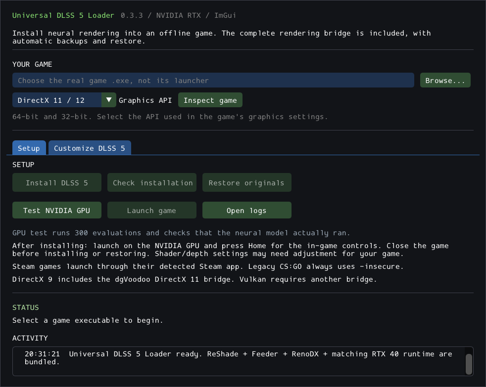

# Universal DLSS 5 Loader

A native Windows app for installing, customizing, checking, and restoring a community DLSS 5 neural rendering pipeline in games. Built with C++20, Dear ImGui, and a Python backend.



## Features

- Install ReShade, DLSS5-Feeder, RenoDX, motion-vector shaders, and matching SR/NR runtimes from a prepared local payload.
- Support x64 and x86 DirectX 11/12 and OpenGL games, plus DirectX 9 through dgVoodoo. Vulkan requires an additional bridge.
- Adjust strength, color, tone, detail, skin detail, masking, model style, resolution, passes, and history. Save settings per game.
- Verify payload hashes, back up original files, roll back interrupted installs, and restore originals while retaining edited settings.
- Launch Steam games through their detected installation identity; legacy CS:GO retains `-insecure`.
- Run a real NVIDIA GPU diagnostic that checks neural feature creation and evaluation.

## Requirements

- Windows x64 and an NVIDIA GPU compatible with the selected community runtime. Synthetic rendering was validated on an RTX 4050 Laptop GPU; other hardware needs testing.
- Visual Studio 2022 or Build Tools 2022 with **Desktop development with C++**, an x64 MSVC toolchain, and the Windows SDK.
- CMake 3.24+, Git, and Python 3.9+ (64-bit recommended).
- Internet access for the first build and payload preparation. Installation uses local files after preparation.

The project uses a **community-modified, unsigned NR runtime**. Compatibility depends on the game, graphics API, shaders, and upstream components. The project is independent of NVIDIA; its name does not imply official support or universal compatibility.

## Build and run

Use this single project folder for editing, building, and launching:

- **Launch.cmd** opens the app. On a fresh checkout it automatically builds and prepares missing local components first.
- **Build.cmd** rebuilds, verifies the payload, and runs the tests. Double-click it after editing source.
- **src/** contains the native menu and loader; the root Python files implement installation, settings, and launching.
- **build/**, **payload/**, **packages/**, and **diagnostics/** hold local generated files. They stay inside this folder and are excluded from GitHub.

Clone or extract the source, open PowerShell in the project folder, and run:

```powershell
.\build.ps1
.\Launch.cmd
```

If PowerShell blocks local scripts, run the build with a process-local override:

```powershell
powershell.exe -NoProfile -ExecutionPolicy Bypass -File .\build.ps1
```

The build downloads Dear ImGui, compiles `build\Release\Dlss5Setup.exe`, prepares missing rendering payloads, verifies their hashes, and runs the automated tests. Downloads and staging stay inside the project folder. Keep that folder intact: the executable needs its backend, schema, generated payload, and the Python interpreter selected during the build.

To select an interpreter explicitly:

```powershell
.\build.ps1 -PythonExecutable 'C:\Path\To\python.exe'
```

To compile and run tests that do not require the rendering payload:

```powershell
.\build.ps1 -SourceOnly
```

A source-only build is intended for development and CI. Run the full build before installing into games or testing neural rendering. `Prepare-App.ps1` can also prepare the payload after a source-only build.

## Use

1. Click **Test NVIDIA GPU**.
2. Browse to the actual game executable, choose its graphics API, and close the game.
3. Choose a look in **Customize DLSS 5**, then click **Install DLSS 5**.
4. Launch on the NVIDIA GPU. Press **Home** for the in-game controls; depth and shader settings may need adjustment.
5. Use **Check installation** to verify files and inspect recent rendering logs.
6. Close the game before applying settings, repairing an installation, or restoring originals.

For an installed game, **Load game settings** reads its current values and **Apply to game** saves the selected values for the next launch. x86 games store neural settings in the 64-bit helper's configuration.

**Restore originals** removes managed files and restores exact backups. Edited settings and previous installation records remain in `.dlss5-setup-history-*` in the game folder. Unrelated game files and saves are preserved.

DirectX 9 setup uses dgVoodoo 2.87.5 with DirectX 11 output, 1 GB emulated VRAM, and depth copying. On hybrid GPUs it records and sets Windows high-performance graphics preferences for the selected executable and helper. Restore recovers prior preferences unless they were subsequently edited. **Repair DirectX 9 setup** migrates an existing managed legacy CS:GO installation while retaining its settings and backups.

## Troubleshooting and compatibility

- Existing proxy DLL or addon conflicts, running games, changed payloads, and damaged backups stop installation or restore. Read the reported error before changing files.
- Check `setup.log`, the operation results in `jobs/`, and rendering logs in the game folder or `diagnostics/host64/`. **Open logs** opens the relevant folder.
- If preparation reports a hash mismatch, stop and investigate the upstream asset. Do not disable verification. Some shader sources use upstream branches and may need a reviewed dependency update if they change.
- The installer does not filter online clients by executable name or anti-cheat folders. It does not bypass anti-cheat or DRM; compatibility with protected clients has not been established.
- A successful synthetic GPU test establishes neural model execution, not game image quality, performance, or universal game support. End-to-end legacy CS:GO testing remains pending.

## Validation and development

The recorded RTX 4050 tests completed 300/300 neural evaluations, including customized Natural and Cinematic settings. An x86 DirectX 9 fixture also presented frames through the helper with feature 18 active. See [validation](docs/VALIDATION.md), [DirectX 9 evidence](docs/csgo-d3d9-validation.md), and [development history](MODLOG.md) for scope and limitations.

GitHub Actions builds Windows x64 source and runs the native loader and Steam routing tests. Installer lifecycle tests need the locally prepared payload; real GPU tests require compatible hardware and are manual.

See [contributing](CONTRIBUTING.md), [changelog](CHANGELOG.md), and [GitHub upload notes](docs/GITHUB_UPLOAD.md).

## Credits and license

Project code is licensed under [MIT](LICENSE). Third-party components keep their own licenses and terms; see [THIRD_PARTY_NOTICES.md](THIRD_PARTY_NOTICES.md).

Thanks to [Dear ImGui](https://github.com/ocornut/imgui), [nlohmann/json](https://github.com/nlohmann/json), [DLSS5-Feeder](https://github.com/jlrouzies-fr/DLSS5-Feeder), [ReShade](https://reshade.me), [RenoDX consumer releases](https://github.com/RankFTW/rhi-repo/releases/tag/renodx-dlss5-7.0.0-rc8), [LumeniteFX](https://github.com/umar-afzaal/LumeniteFX), [dgVoodoo](https://github.com/dege-diosg/dgVoodoo2), and [NVIDIA's DLSS SDK](https://github.com/NVIDIA/DLSS).

Developed with assistance from OpenAI Codex; repository preparation in this session used GPT-6. Dependency provenance and runtime hashes are retained in the preparation scripts, payload manifests, and `runtime/provenance.json`.

This repository and its source archive exclude downloaded runtime binaries, game files, build outputs, local settings, and logs. Rebuild and acquire dependencies from their upstream sources; this repository's MIT license does not grant redistribution rights for those components.
